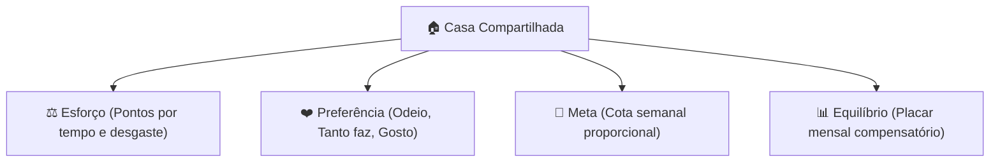
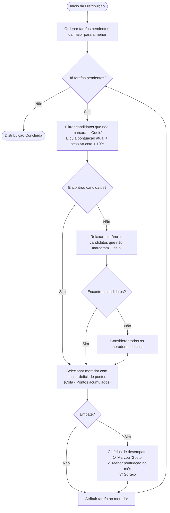

# 🏠 Sua Vez — Rodízio Justo de Tarefas Domésticas


O **Sua Vez** é um aplicativo Android concebido para dividir tarefas residenciais de maneira transparente, justa e equilibrada entre moradores de repúblicas, apartamentos compartilhados ou famílias. 

Diferente de checklists convencionais que tratam tarefas desiguais com o mesmo peso, o **Sua Vez** atua como um árbitro neutro: quantifica o esforço real de cada tarefa, respeita as preferências pessoais de cada morador, define metas semanais equilibradas e compensa desvios pelo histórico mensal.

---

## 👥 Equipe e Contexto Acadêmico

Projeto desenvolvido como trabalho final da disciplina de **Programação para Dispositivos Móveis**, do curso de **Engenharia de Software** do **IFPE — Campus Belo Jardim**.

- **Maria Letícia**
- **Caio Vinícius**
- **Pedro Xavier**

---

## 🎯 O Problema

Em residências compartilhadas, a sensação de que "um faz mais do que o outro" costuma gerar desgastes e atritos na convivência. Esse cenário é agravado por três causas principais:
1. **Esforço ignorado:** Listas simples consideram apenas quantidade bruta (lavar o banheiro tem o mesmo peso de levar o lixo para fora).
2. **Trabalho invisível:** Comprar suprimentos ou gerenciar contas raramente entra nas divisões de tarefas cotidianas.
3. **Preferências desconsideradas:** Obrigações são impostas sem considerar o que cada morador tolera melhor ou pior.

O **Sua Vez** introduz uma régua de justiça clara, objetiva e acordada por todos.

---

## 💡 Os Quatro Pilares da Solução



- **Esforço:** Cada tarefa tem uma pontuação baseada em seu tempo estimado e nível de desgaste.
- **Preferência:** Cada morador indica seu sentimento por tarefa (*Odeio*, *Tanto faz* ou *Gosto*).
- **Meta (Cota Semanal):** Distribuição matemática proporcional à soma dos pontos da semana.
- **Equilíbrio:** Acompanhamento mensal cumulativo para desempates e compensações contínuas.

---

## ⚙️ Regras do Sistema e Algoritmo

### 1. Cálculo da Cota Semanal
A cota de cada morador é calculada dividindo a pontuação total das tarefas cadastradas na semana pelo número de membros da casa, admitindo uma faixa de tolerância de ±10%:

```
cota = soma(pesos das tarefas da semana) / numero_de_moradores
```

### 2. Escolha Livre e Notificação
Os moradores têm autonomia para selecionar previamente as tarefas que preferem. Ao atingir ou ultrapassar a cota semanal, o morador recebe um aviso informativo amigável — sem bloqueios arbitrários, preservando a autonomia de quem deseja contribuir mais.

### 3. Distribuição Gulosa de Pendentes
Tarefas não selecionadas são distribuídas automaticamente através do botão **"Distribuir pendentes"**, priorizando as mais pesadas para facilitar o encaixe das cotas:



---

## 📱 Telas e Navegação

A arquitetura de navegação é centrada em uma `Activity` principal que coordena múltiplos `Fragments` gerenciados pelo **Android Navigation Component**, estruturados em uma barra de navegação inferior (*Bottom Navigation*):

| Tela | Finalidade Principal |
|---|---|
| **Login e Cadastro** | Autenticação do morador no sistema |
| **Casa** | Criação de uma nova residência ou ingresso via código de convite |
| **Tarefas da Semana** | Visualização das tarefas abertas, próprias e concluídas, com barra de progresso da cota |
| **Preferências** | Matriz de preferência individual por tarefa (*Odeio*, *Tanto faz*, *Gosto*) |
| **Placar** | Pontuação acumulada mensal e ranking de colaboração |
| **Configurações** | Gestão de tarefas, pesos, categorias e código de compartilhamento |

---

## 🛠️ Tecnologias e Arquitetura

- **Linguagem:** [Kotlin](https://kotlinlang.org/)
- **Camada de Apresentação:** Android Nativo (`Activity` + `Fragments`, Views em XML, Navigation Component)
- **Autenticação:** [Firebase Authentication](https://firebase.google.com/docs/auth)
- **Banco de Dados em Tempo Real:** [Cloud Firestore](https://firebase.google.com/docs/firestore)
- **Versionamento:** Git & GitHub

### Modelagem de Dados (Firestore)
```
houses/{houseId}
├── nome, codigoConvite, criadaEm
├── members/{uid}              -> nome, pontosMes
├── tasks/{taskId}             -> titulo, peso, categoria
├── preferences/{uid_taskId}   -> uid, taskId, nivel (odeio | tanto_faz | gosto)
└── assignments/{id}           -> taskId, uid, semana, status, concluidaEm, pontos
```

---

## 🚀 Como Executar o Projeto

### Pré-requisitos
- [Android Studio](https://developer.android.com/studio) Ladybug ou superior
- JDK 11 ou superior configurado
- Dispositivo Android físico ou Emulador (API 24+)

### Passos de Instalação
1. **Clone o repositório:**
   ```bash
   git clone https://github.com/seu-usuario/SuaVez.git
   cd SuaVez
   ```

2. **Abra o projeto no Android Studio:**
   - Selecione `Open...` e aponte para a pasta raiz do projeto.
   - Aguarde a sincronização inicial das dependências do Gradle.

3. **Configuração do Firebase:**
   - O projeto utiliza os serviços de autenticação e banco de dados do Firebase. Certifique-se de incluir o arquivo `google-services.json` no diretório `/app` devidamente associado ao pacote `xavier.pedro.suavez`.

4. **Compilação e Execução:**
   - Selecione a variante de build desejada e clique em **Run (`Shift + F10`)** no Android Studio.

---

## 📄 Licença

Este projeto foi desenvolvido para fins educacionais e de pesquisa acadêmica no âmbito do **IFPE Campus Belo Jardim**.
