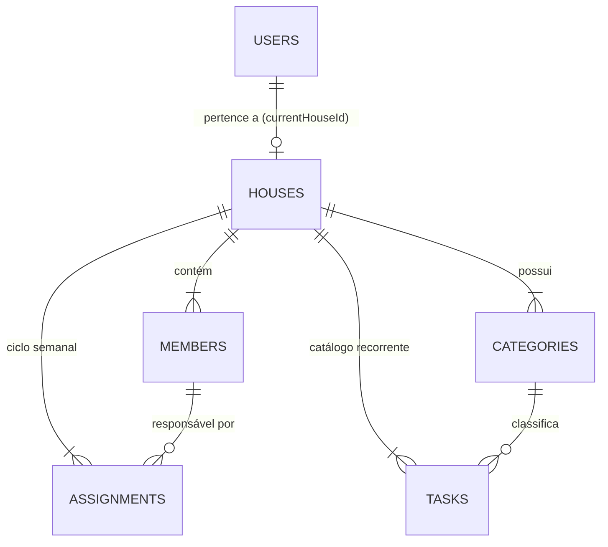
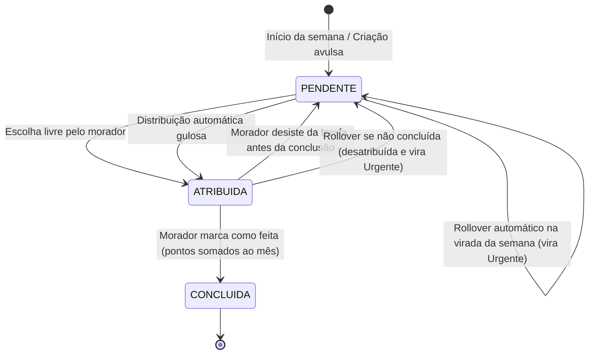

# 🗄️ Esquema do Banco de Dados Cloud Firestore — Sua Vez

Este documento detalha o modelo NoSQL no Cloud Firestore para o aplicativo **Sua Vez**, cobrindo coleções, documentos, subcoleções, tipos de dados, ciclo de vida e permissões acordadas durante a etapa de modelagem de requisitos.

---

## 📐 Visão Geral da Arquitetura

O Firestore organiza os dados em documentos e coleções hierárquicas. Para otimizar consultas, economizar leituras em tempo real e garantir isolamento entre residências, a arquitetura é estruturada em:

1. **Coleção Raiz `users`**: Perfis dos usuários autenticados via Firebase Auth e roteamento rápido para a casa atual.
2. **Coleção Raiz `houses`**: Configurações gerais da casa, código de convite e controle do ciclo semanal.
3. **Subcoleções em `houses/{houseId}`**:
   - `members`: Moradores da casa, papéis (ADMIN/MEMBER), histórico de pontuação mensal e mapa de preferências.
   - `categories`: Categorias de tarefas da casa (ex: Limpeza, Compras, Contas) com metadados visuais (cor e ícone).
   - `tasks`: Catálogo de tarefas recorrentes gerenciado pelos administradores da casa.
   - `assignments`: Atribuições da semana com dados desnormalizados, ciclo de status, suporte a tarefas avulsas e rollover de semanas anteriores.

---

## 🗂️ Estrutura Detalhada das Coleções

### 1. Coleção Raiz: `users/{uid}`
Armazena os dados cadastrais do morador após autenticação (Firebase Auth). O `documentId` é o próprio `uid` do Firebase Auth.

| Campo | Tipo | Descrição |
|---|---|---|
| `uid` | `String` | Identificador único do usuário no Firebase Auth |
| `nome` | `String` | Nome de exibição do morador |
| `email` | `String` | E-mail do morador |
| `fotoUrl` | `String?` | URL da foto de perfil (opcional) |
| `currentHouseId` | `String?` | ID da casa ativa do morador (nulo se ainda não entrou em uma casa) |
| `criadoEm` | `Timestamp` | Data/hora de criação do perfil |

---

### 2. Coleção Raiz: `houses/{houseId}`
Armazena os metadados de uma residência compartilhada.

| Campo | Tipo | Descrição |
|---|---|---|
| `id` | `String` | ID único da casa (gerado automaticamente pelo Firestore) |
| `nome` | `String` | Nome da casa/república (ex: "República dos Cravos") |
| `codigoConvite` | `String` | Código alfanumérico curto (ex: "SV4X89") para novos moradores entrarem |
| `criadaPorUid` | `String` | `uid` do usuário que fundou a casa |
| `criadaEm` | `Timestamp` | Data/hora de fundação da casa |
| `semanaAtual` | `String` | Identificador da semana ISO corrente (ex: `"2026-W46"`) |

> **Índice necessário:** Consulta por `codigoConvite` com `whereEqualTo("codigoConvite", code)`.

---

### 3. Subcoleção: `houses/{houseId}/members/{uid}`
Representa cada morador dentro do contexto da casa. O `documentId` é o `uid` do morador.

| Campo | Tipo | Descrição |
|---|---|---|
| `uid` | `String` | UID do morador |
| `nome` | `String` | Nome do morador na casa |
| `fotoUrl` | `String?` | Foto de perfil do morador |
| `papel` | `String` | Papel na casa: `"ADMIN"` ou `"MEMBER"` |
| `pontosPorMes` | `Map<String, Int>` | Histórico de pontuação por mês (ex: `{"2026-10": 42, "2026-11": 25}`). O placar mensal lê a chave do mês corrente |
| `preferences` | `Map<String, String>` | Mapa de afinidade por tarefa do catálogo: `{ taskId: "ODEIO" \| "TANTO_FAZ" \| "GOSTO" }` |
| `entrouEm` | `Timestamp` | Data/hora de ingresso na casa |

---

### 4. Subcoleção: `houses/{houseId}/categories/{categoryId}`
Categorias personalizáveis da casa, permitindo agrupamento visual e contextual das tarefas.

| Campo | Tipo | Descrição |
|---|---|---|
| `id` | `String` | ID único da categoria |
| `nome` | `String` | Nome da categoria (ex: "Limpeza", "Compras", "Contas", "Pets") |
| `icone` | `String` | Identificador ou nome do ícone do Material/Compose (ex: `"cleaning_services"`) |
| `corHex` | `String` | Código hexadecimal de cor para UI (ex: `"#4CAF50"`) |
| `padrao` | `Boolean` | Indica se é uma categoria padrão do sistema gerada na criação da casa |

---

### 5. Subcoleção: `houses/{houseId}/tasks/{taskId}` (Catálogo Recorrente)
Catálogo base de tarefas recorrentes que se repetem a cada semana. Gerenciado exclusivamente por moradores com papel `ADMIN`.

| Campo | Tipo | Descrição |
|---|---|---|
| `id` | `String` | ID único da tarefa no catálogo |
| `titulo` | `String` | Título da tarefa (ex: "Lavar banheiro social") |
| `descricao` | `String` | Instruções ou detalhes adicionais |
| `peso` | `Int` | Pontuação da tarefa: 1 (Leve), 3 (Média) ou 5 (Pesada) |
| `pesoNivel` | `String` | Nível selecionado: `"LIGHT"`, `"MEDIUM"` ou `"HEAVY"` |
| `categoriaId` | `String` | ID da categoria associada |
| `categoriaNome` | `String` | Nome da categoria denormalizado para leitura rápida |
| `ativa` | `Boolean` | Se a tarefa está ativa para entrar na geração semanal |
| `criadaPorUid` | `String` | UID do administrador que cadastrou a tarefa |
| `criadaEm` | `Timestamp` | Data/hora de cadastro |

---

### 6. Subcoleção: `houses/{houseId}/assignments/{assignmentId}` (Instâncias Semanais)
Tarefas específicas de uma semana determinada, com dados desnormalizados para que a listagem da semana seja realizada em apenas **uma única leitura** no Firestore.

| Campo | Tipo | Descrição |
|---|---|---|
| `id` | `String` | ID único da atribuição na semana |
| `semana` | `String` | Chave da semana civil ISO (ex: `"2026-W46"`) |
| `taskId` | `String?` | ID da tarefa no catálogo base (nulo se for tarefa avulsa) |
| `titulo` | `String` | Título da tarefa |
| `descricao` | `String` | Detalhes adicionais |
| `peso` | `Int` | Pontos atribuídos à tarefa (1, 3 ou 5) |
| `categoriaId` | `String` | ID da categoria |
| `categoriaNome` | `String` | Nome da categoria |
| `status` | `String` | Estado: `"PENDENTE"`, `"ATRIBUIDA"` ou `"CONCLUIDA"` |
| `responsavelUid` | `String?` | UID do morador encarregado (`null` se estiver pendente) |
| `responsavelNome` | `String?` | Nome do morador encarregado |
| `ehAvulsa` | `Boolean` | `true` se criada diretamente na semana por qualquer morador |
| `ehRollover` | `Boolean` | `true` se acumulada da semana anterior por não ter sido concluída |
| `urgente` | `Boolean` | `true` para tarefas rollover ou marcadas com alta prioridade |
| `semanaOrigem` | `String?` | Semana de origem no caso de tarefas que sofreram rollover |
| `distribuidaAutomaticamente` | `Boolean` | `true` se foi designada pelo algoritmo guloso |
| `criadaPorUid` | `String` | UID de quem gerou ou cadastrou a tarefa |
| `concluidaEm` | `Timestamp?` | Data/hora exata em que foi marcada como feita |

---

## 🔄 Regras de Negócio e Transições de Estado

### 1. Ciclo de Vida da Tarefa Semanal (`Assignment`)

### 2. Virada de Semana e Rollover Automático
- O app verifica o código da semana civil ISO atual (ex: `2026-W46`).
- Se a casa ainda estiver com `semanaAtual` apontando para a semana anterior:
  1. As tarefas não concluídas (`status != "CONCLUIDA"`) são transferidas para a nova semana com `ehRollover = true`, `urgente = true`, `status = "PENDENTE"` e `responsavelUid = null`.
  2. As tarefas ativas do catálogo (`tasks`) que ainda não existem na nova semana são instanciadas como `PENDENTE`.
  3. O campo `houses/{houseId}.semanaAtual` é atualizado para a nova semana.

### 3. Conclusão e Pontuação Mensal
Quando um morador conclui uma tarefa:
1. `status` é alterado para `"CONCLUIDA"` e `concluidaEm` recebe o `FieldValue.serverTimestamp()`.
2. O histórico do membro (`members/{uid}.pontosPorMes[mesAtual]`) é incrementado com o `peso` da tarefa via `FieldValue.increment(peso)`.

### 4. Papéis e Permissões

| Ação | Administrador (`ADMIN`) | Morador (`MEMBER`) |
|---|:---:|:---:|
| Editar dados da casa / Regenerar código | ✅ | ❌ |
| Criar/editar categorias | ✅ | ❌ |
| Cadastrar tarefas no catálogo recorrente | ✅ | ❌ |
| Criar tarefas avulsas na semana corrente | ✅ | ✅ |
| Marcar preferências (Odeio, Tanto faz, Gosto) | ✅ | ✅ |
| Escolher tarefas abertas até a cota | ✅ | ✅ |
| Disparar "Distribuir Pendentes" | ✅ | ✅ |
| Concluir tarefas atribuídas a si | ✅ | ✅ |
